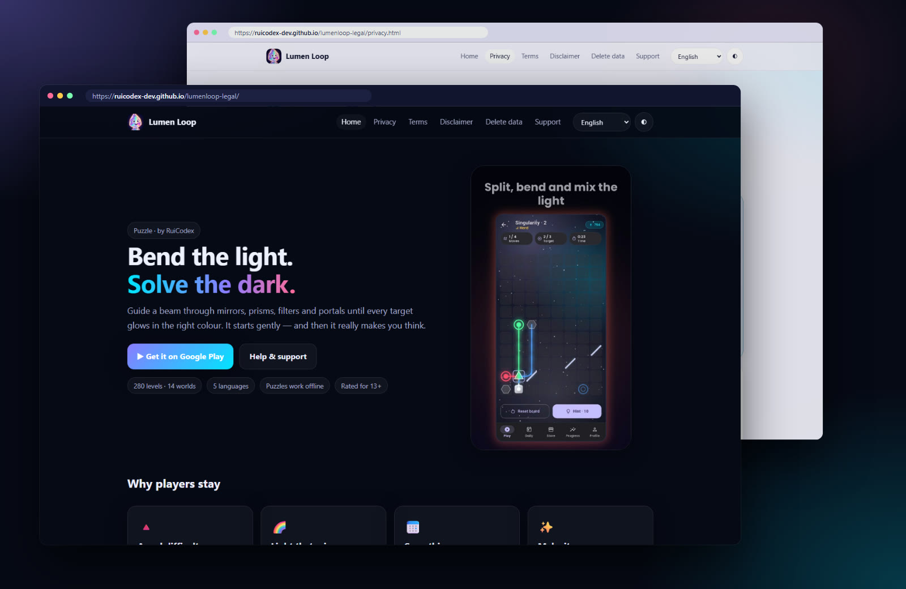
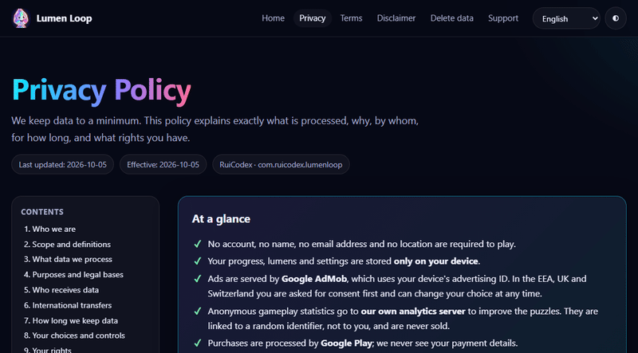
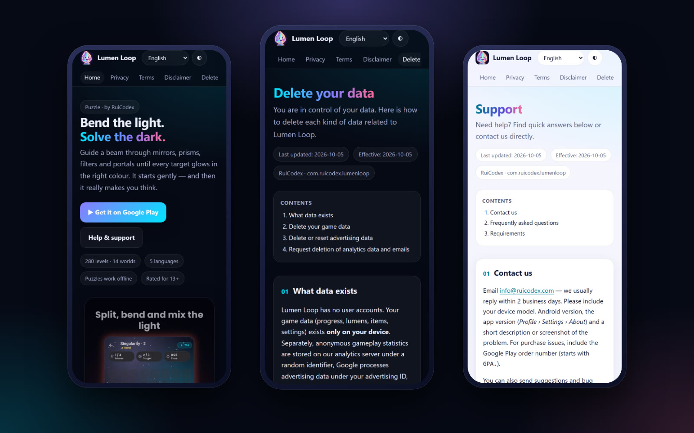
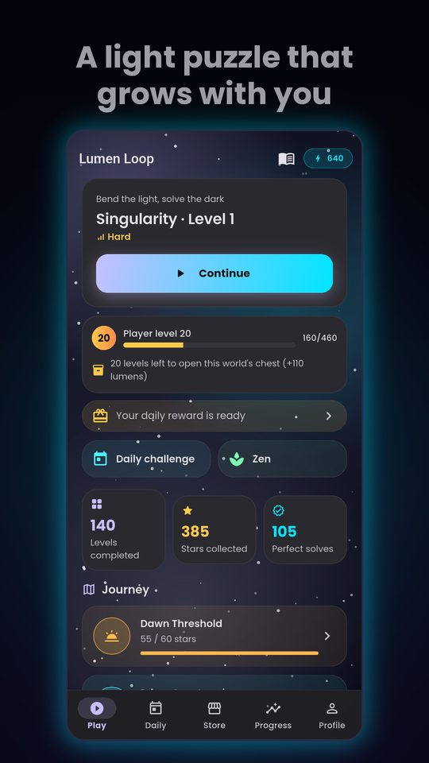
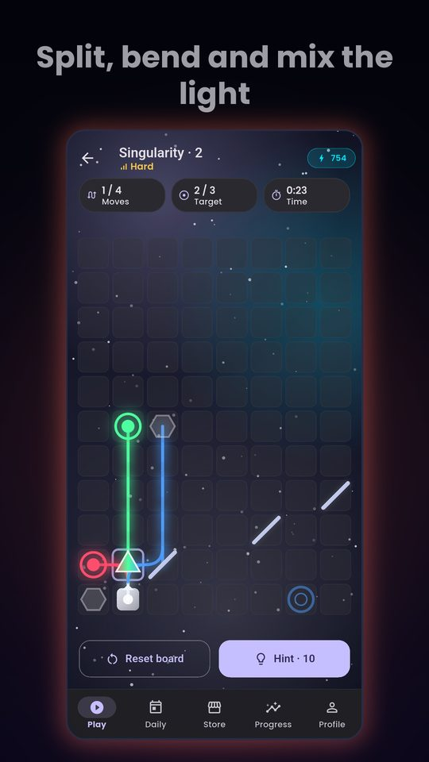
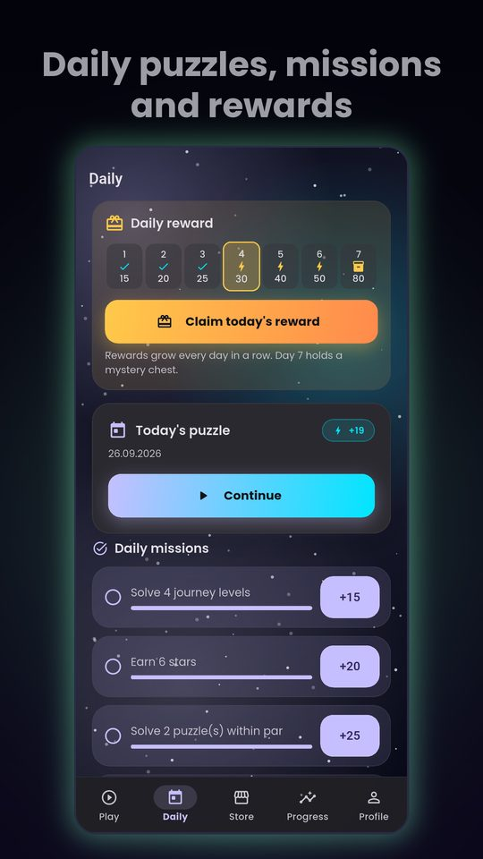
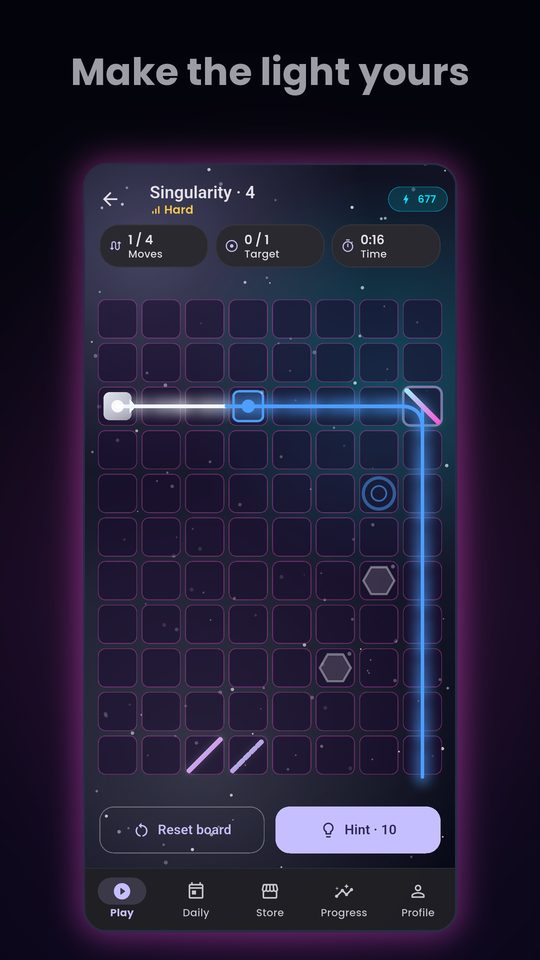
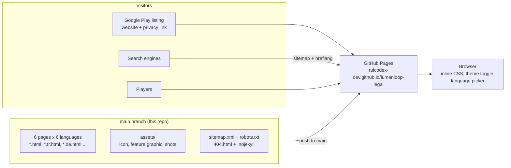

<div align="center">

<a href="https://ruicodex-dev.github.io/lumenloop-legal/">
  <picture>
    
  </picture>
</a>

### The privacy, terms and support home of **Lumen Loop**, the light-bending puzzle game by Rui Codex.


**[Live site](https://ruicodex-dev.github.io/lumenloop-legal/)** &nbsp;·&nbsp;
[Privacy](https://ruicodex-dev.github.io/lumenloop-legal/privacy.html) &nbsp;·&nbsp;
[Terms](https://ruicodex-dev.github.io/lumenloop-legal/terms.html) &nbsp;·&nbsp;
[Delete data](https://ruicodex-dev.github.io/lumenloop-legal/delete-data.html) &nbsp;·&nbsp;
[Support](https://ruicodex-dev.github.io/lumenloop-legal/support.html) &nbsp;·&nbsp;
[Get the game](https://play.google.com/store/apps/details?id=com.ruicodex.lumenloop)

</div>

<br>

<p align="center">
  <a href="https://ruicodex-dev.github.io/lumenloop-legal/">
    
  </a>
  <br>
  <sub>The live site: home in dark theme, the Privacy Policy in light theme. Real captures of ruicodex-dev.github.io/lumenloop-legal.</sub>
</p>

## What this is

This repository **is** the website. Every page is a hand-written, self-contained HTML file served by GitHub Pages straight from `main`.
It gives [Lumen Loop](https://play.google.com/store/apps/details?id=com.ruicodex.lumenloop) (`com.ruicodex.lumenloop`) a public home for the documents a store listing needs:
a game landing page, the Privacy Policy, Terms of Use, a Disclaimer, a step-by-step data deletion guide and a support page with FAQs.
The game's Google Play listing links here for its website and privacy policy.

<table>
  <tr>
    <td width="33%" valign="top">🔒 <b>Plain-language privacy</b><br>An "At a glance" box up front, then 14 numbered sections: data, legal bases, recipients, retention, rights.</td>
    <td width="33%" valign="top">🌍 <b>Six languages</b><br>English, Türkçe, Deutsch, Español, Français and Nederlands, linked with <code>hreflang</code> alternates.</td>
    <td width="33%" valign="top">🗑️ <b>Delete-data guide</b><br>How to erase game data, reset the advertising ID and request deletion of analytics data and emails.</td>
  </tr>
  <tr>
    <td width="33%" valign="top">🌗 <b>Light and dark</b><br>Follows the system theme, with a toggle that remembers your choice in the browser.</td>
    <td width="33%" valign="top">📱 <b>Mobile first</b><br>Sticky header, scrollable nav, stacked tables and a print stylesheet for the legal pages.</td>
    <td width="33%" valign="top">⚡ <b>Zero build</b><br>No framework, no bundler, no external fonts or trackers. Inline CSS and a few lines of JS per page.</td>
  </tr>
</table>

## The pages

Six documents, each in six languages: 36 pages plus a 404, a `sitemap.xml` and `robots.txt`.

| Page | What it covers | EN | TR | DE | ES | FR | NL |
|---|---|:-:|:-:|:-:|:-:|:-:|:-:|
| **Home** | The game, its features, screenshots, honest notes on ads and purchases | [en](https://ruicodex-dev.github.io/lumenloop-legal/index.html) | [tr](https://ruicodex-dev.github.io/lumenloop-legal/index.tr.html) | [de](https://ruicodex-dev.github.io/lumenloop-legal/index.de.html) | [es](https://ruicodex-dev.github.io/lumenloop-legal/index.es.html) | [fr](https://ruicodex-dev.github.io/lumenloop-legal/index.fr.html) | [nl](https://ruicodex-dev.github.io/lumenloop-legal/index.nl.html) |
| **Privacy Policy** | What data is processed, why, by whom, for how long, and your rights under the GDPR | [en](https://ruicodex-dev.github.io/lumenloop-legal/privacy.html) | [tr](https://ruicodex-dev.github.io/lumenloop-legal/privacy.tr.html) | [de](https://ruicodex-dev.github.io/lumenloop-legal/privacy.de.html) | [es](https://ruicodex-dev.github.io/lumenloop-legal/privacy.es.html) | [fr](https://ruicodex-dev.github.io/lumenloop-legal/privacy.fr.html) | [nl](https://ruicodex-dev.github.io/lumenloop-legal/privacy.nl.html) |
| **Terms of Use** | Licence, virtual items, purchases and refunds, ads and rewards, health and safety | [en](https://ruicodex-dev.github.io/lumenloop-legal/terms.html) | [tr](https://ruicodex-dev.github.io/lumenloop-legal/terms.tr.html) | [de](https://ruicodex-dev.github.io/lumenloop-legal/terms.de.html) | [es](https://ruicodex-dev.github.io/lumenloop-legal/terms.es.html) | [fr](https://ruicodex-dev.github.io/lumenloop-legal/terms.fr.html) | [nl](https://ruicodex-dev.github.io/lumenloop-legal/terms.nl.html) |
| **Disclaimer** | No warranty, on-device progress and data loss, puzzle "par", third-party ads | [en](https://ruicodex-dev.github.io/lumenloop-legal/disclaimer.html) | [tr](https://ruicodex-dev.github.io/lumenloop-legal/disclaimer.tr.html) | [de](https://ruicodex-dev.github.io/lumenloop-legal/disclaimer.de.html) | [es](https://ruicodex-dev.github.io/lumenloop-legal/disclaimer.es.html) | [fr](https://ruicodex-dev.github.io/lumenloop-legal/disclaimer.fr.html) | [nl](https://ruicodex-dev.github.io/lumenloop-legal/disclaimer.nl.html) |
| **Delete data** | Step-by-step deletion of game, advertising and analytics data | [en](https://ruicodex-dev.github.io/lumenloop-legal/delete-data.html) | [tr](https://ruicodex-dev.github.io/lumenloop-legal/delete-data.tr.html) | [de](https://ruicodex-dev.github.io/lumenloop-legal/delete-data.de.html) | [es](https://ruicodex-dev.github.io/lumenloop-legal/delete-data.es.html) | [fr](https://ruicodex-dev.github.io/lumenloop-legal/delete-data.fr.html) | [nl](https://ruicodex-dev.github.io/lumenloop-legal/delete-data.nl.html) |
| **Support** | Contact, FAQ (hints, purchases, restore, refunds) and requirements | [en](https://ruicodex-dev.github.io/lumenloop-legal/support.html) | [tr](https://ruicodex-dev.github.io/lumenloop-legal/support.tr.html) | [de](https://ruicodex-dev.github.io/lumenloop-legal/support.de.html) | [es](https://ruicodex-dev.github.io/lumenloop-legal/support.es.html) | [fr](https://ruicodex-dev.github.io/lumenloop-legal/support.fr.html) | [nl](https://ruicodex-dev.github.io/lumenloop-legal/support.nl.html) |

<table>
  <tr>
    <td width="58%" valign="middle">
      
    </td>
    <td width="42%" valign="middle">
      <h3>One policy, six languages</h3>
      Every page has a language picker in the header and <code>hreflang</code> alternates (plus <code>x-default</code>) in its head, so search engines and stores can send people to their own language.
      <br><br>
      Translations are provided for convenience: if versions differ, the English text prevails unless mandatory law says otherwise.
    </td>
  </tr>
</table>

## On a phone

<p align="center">
  
  <br>
  <sub>Home, Delete data and Support at 390 × 844. Real captures of the live site.</sub>
</p>

## The game these pages cover

Lumen Loop is a free puzzle game for Android: guide a beam through mirrors, prisms, filters and portals until every target glows in the right colour.
280 levels across 14 worlds, a daily puzzle and missions, and a calm Zen mode. The site uses the game's own store screenshots:

<table>
  <tr>
    <td align="center" width="25%"><br><sub>Journey map</sub></td>
    <td align="center" width="25%"><br><sub>A prism splitting light</sub></td>
    <td align="center" width="25%"><br><sub>Daily rewards and missions</sub></td>
    <td align="center" width="25%"><br><sub>The Neon beam theme</sub></td>
  </tr>
</table>

<p align="center"><a href="https://play.google.com/store/apps/details?id=com.ruicodex.lumenloop"><b>▶ Get Lumen Loop on Google Play</b></a></p>

## How it works



- **Pages are static.** Each file carries its own inline `<style>` with CSS custom properties for the dark and light palettes, so there is nothing to build or fetch.
- **Theme:** `prefers-color-scheme` by default; the ◐ button sets `data-theme` on `<html>` and remembers it in `localStorage` under `ll-theme`.
- **Language:** a `<select>` in the header jumps to the same page in another locale; `<link rel="alternate" hreflang>` tags describe the set.
- **SEO and sharing:** canonical URLs, Open Graph title, description and image (`assets/feature.png`), and a sitemap with `lastmod` dates.
- **`.nojekyll`** tells GitHub Pages to serve the files exactly as they are.

## Tech stack

| Layer | Choice |
|---|---|
| Markup | Hand-written HTML5, one file per page and language |
| Styling | Inline CSS with custom properties, `color-mix()`, `backdrop-filter`, responsive and print rules |
| Script | A few lines of vanilla JS for the theme toggle; the language picker is a plain `<select>` |
| Hosting | GitHub Pages, from the root of `main` |
| Discovery | `sitemap.xml`, `robots.txt`, canonical and `hreflang` links, Open Graph tags |
| Fonts and tracking | None loaded: system font stack, no analytics or third-party scripts on the site |

## Getting started

**Prerequisites:** Git and any static file server (Python 3 is enough). There are no dependencies and no environment variables.

```bash
git clone https://github.com/RuiCodex-dev/lumenloop-legal.git
cd lumenloop-legal
python -m http.server 8000
# open http://localhost:8000/index.html
```

Opening `index.html` directly in a browser works too.

<details>
<summary><b>Editing a policy</b></summary>

1. Change the English page first (for example `privacy.html`); it is the version that prevails.
2. Apply the same change to the five translations: `privacy.tr.html`, `privacy.de.html`, `privacy.es.html`, `privacy.fr.html`, `privacy.nl.html`.
3. Update the **Last updated** and **Effective** chips at the top of each changed page.
4. Update the matching `<lastmod>` entries in `sitemap.xml`.
5. Commit and push to `main`. GitHub Pages republishes the site within a minute or two.

</details>

<details>
<summary><b>Adding a page or a language</b></summary>

- Copy an existing page as a template so the header, footer, theme script and styles stay identical.
- Add the new link to the header nav and footer nav of **every** page, and to the language `<select>` if it is a new locale.
- Add `<link rel="alternate" hreflang="..">` entries for the new file to all its siblings, and a `<url>` to `sitemap.xml`.

</details>

## Project structure

```text
lumenloop-legal/
├── index*.html          # Game landing page (en, tr, de, es, fr, nl)
├── privacy*.html        # Privacy Policy
├── terms*.html          # Terms of Use
├── disclaimer*.html     # Disclaimer
├── delete-data*.html    # How to delete your data
├── support*.html        # Contact, FAQ and requirements
├── 404.html             # Not-found page
├── assets/              # icon.png, feature.png, shots/<lang>_1..6.jpg
├── docs/media/          # README banner, badges and captures
├── sitemap.xml
├── robots.txt
└── .nojekyll
```

## FAQ

<details>
<summary><b>Where do I send a privacy or deletion request?</b></summary>

Follow the [Delete data](https://ruicodex-dev.github.io/lumenloop-legal/delete-data.html) guide. For analytics data and emails, write to info@ruicodex.com with the subject "Delete my data – Lumen Loop", as described on that page.

</details>

<details>
<summary><b>Does Lumen Loop have accounts?</b></summary>

No. According to the Privacy Policy, no account, name, email address or location is needed to play, and progress is stored only on the device. Purchases are handled by Google Play.

</details>

<details>
<summary><b>Which language version applies?</b></summary>

Translations are provided for convenience. If versions differ, the English version prevails unless mandatory law provides otherwise.

</details>

<details>
<summary><b>What does the game need to run?</b></summary>

Android 7.0 or later. Puzzles work offline; ads, purchases and statistics need an internet connection. The game itself is available in English, Turkish, German, Spanish and French.

</details>

<details>
<summary><b>I need help with the game.</b></summary>

See the [Support](https://ruicodex-dev.github.io/lumenloop-legal/support.html) page for answers on hints, purchases, restoring the Luminary Pass or Remove Ads, and refunds, plus how to contact us.

</details>

---

<div align="center">

<sub>© 2026 Rui Codex. All rights reserved. Google Play and the Google Play logo are trademarks of Google LLC.</sub>
<br>
<sub>Built by <a href="https://ruicodex.com"><b>Rui Codex</b></a></sub>
<br>
<sub>Media credits: the site captures are real Playwright screenshots of the live site; game screenshots are the game's own store screenshots from <code>assets/shots/</code>; the banner and badges are hand-made SVG. No generated imagery is used.</sub>

</div>
